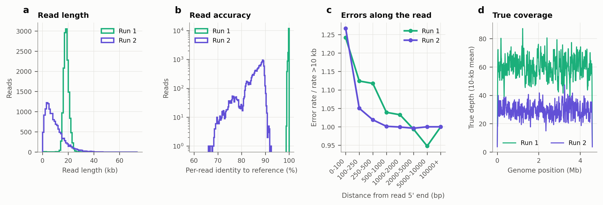
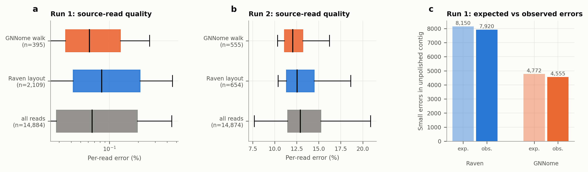
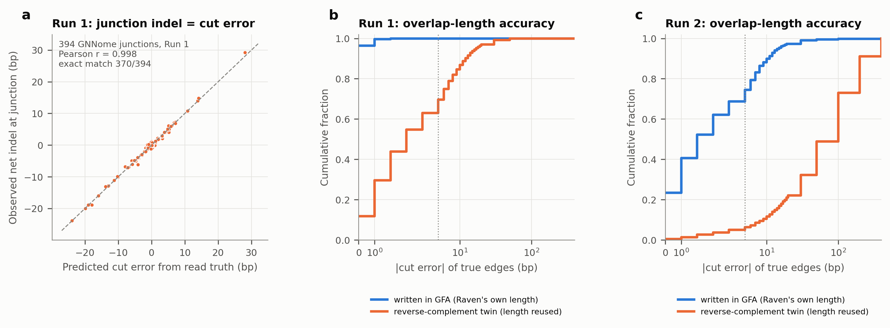
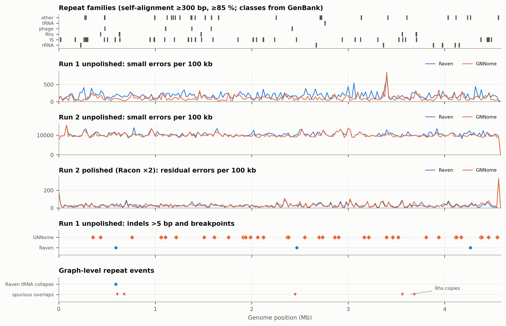
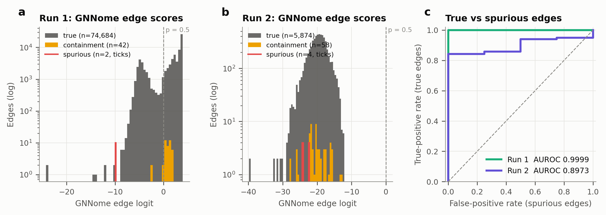
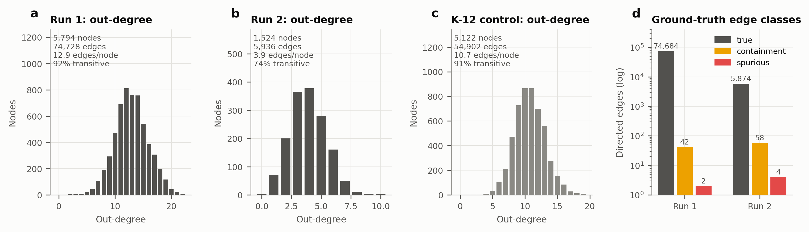
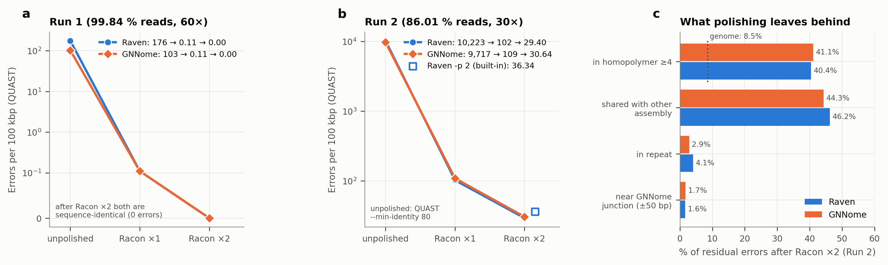
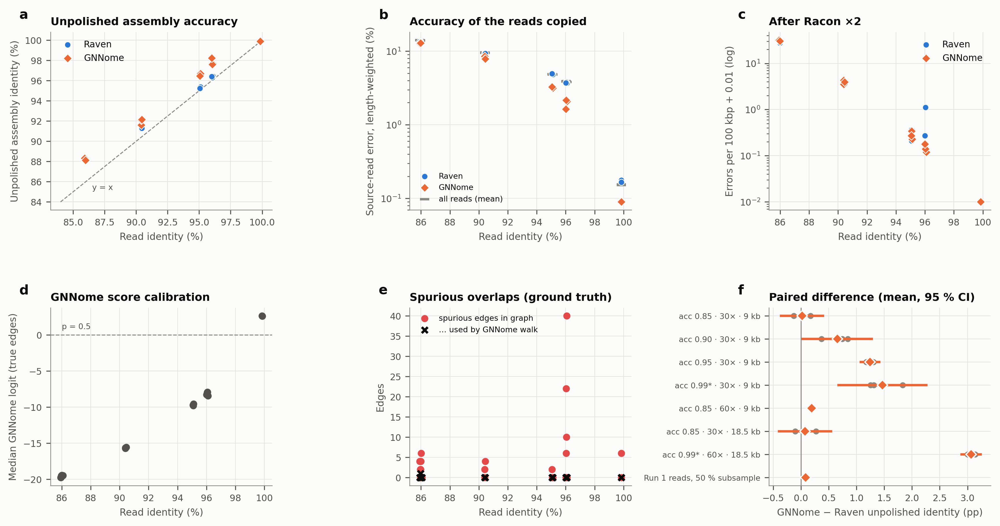
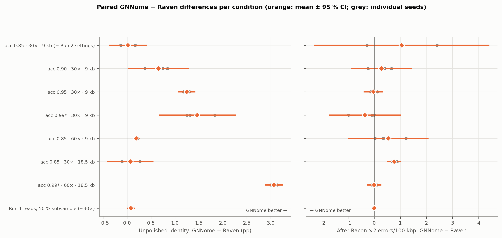

# GNNome on *E. coli* DH5α — Corrected Results and New Findings

**Update to manuscript v28** (*"Where Learned Edge Scoring Breaks: A Repeat-Linked Failure of GNNome on E. coli DH5α"*)
Prepared 12 Nov 2026 · All numbers below are re-verified from files on disk (35/35 automated checks pass, §12).

---

## 1. Summary for the meeting

| | v28 manuscript | This update (verified) |
|---|---|---|
| **What GNNome assembled in "DH5α"** | Assumed DH5α | The v28 DH5α GNNome run consumed a **stale K-12 graph** (proven edge-by-edge). The v28 DH5α GNNome numbers describe K-12, not DH5α. |
| **The "repeat-linked failure"** | 23 misassemblies at a 1,258 bp inverted repeat | That repeat is an **IS3-family insertion element**. The breakpoints are the **IS-mediated ~210 kb inversion that separates K-12 from DH5α**, reproduced exactly when the two *reference genomes* are aligned with no assembler involved. |
| **GNNome vs Raven on DH5α (unpolished)** | GNNome worse | GNNome is **more accurate** in both runs: Run 1 (accurate reads) **44 % fewer mismatches and 41 % fewer indels**; Run 2 (noisy reads) 4.6 % fewer errors (p = 6×10⁻⁹). |
| **Why** | Repeat | **Read selection.** GNNome's walk copies systematically more accurate reads. This **predicts the observed error counts to within 3–5 %**, and holds in **23/23** replicates (p = 2×10⁻⁷). |
| **Weakness of GNNome** | Repeats | Not repeats: **0** spurious (repeat-induced) edges used in any run or replicate. The weakness is an **interface bug**: GNNome reuses Raven's one-directional overlap length for the reverse-complement edge, creating **all** of GNNome's large indels (35/35) and **15/15** of its junction "misassemblies". |
| **After polishing** | — | Advantage disappears. Run 1: Raven and GNNome become **sequence-identical, error-free** assemblies. Run 2: no significant difference. |
| **Replication** | Single run | **21 controlled replicates** (7 conditions × 3 seeds): GNNome's unpolished advantage **grows with read accuracy** (r = 0.95, p = 2×10⁻⁶), up to **+3.1 pp** identity. |

**One-sentence take-away:** *Pretrained GNNome generalizes to a bacterial genome better than v28 concluded. It never traverses a repeat-induced false overlap, and it produces more accurate unpolished assemblies by choosing higher-quality reads. Its only defect is a fixable parser bug, and polishing equalizes the two assemblers.*

---

## 2. What changed and why (integrity)

### 2.1 The v28 DH5α GNNome result was built from the wrong graph
- Raven's Conda build (used for the old Run 2) **does not write** the `graph_1.gfa` that GNNome reads. Only the `print_graphs` fork (commit `3207c8d`) does; a behavioural test on 3,000 reads confirmed this.
- The old GNNome step was therefore pointed at a leftover `graph_1.gfa` from the **K-12 quickstart run**.
- **Edge-level proof:** rebuilding every node and edge from each GFA and comparing it with the DGL graph that `inference.py` loaded gives:

| GNNome run | Graph it actually consumed | Nodes / edges matched |
|---|---|---|
| v28 "DH5α" (old Run 2) | **K-12** `graph_1.gfa` (S = 2,561, L = 27,451) | 5,122 / 54,902 — all |
| Run 1 | DH5α graph (S = 2,897, L = 37,364) | 5,794 / 74,728 — all |
| **Corrected Run 2** | **new DH5α graph** (S = 762, L = 2,968) | **1,524 / 5,936 — all** |

### 2.2 The v28 "1,258 bp repeat" is a K-12 ↔ DH5α structural difference

| Breakpoint (DH5α coords) | K-12 *reference* vs DH5α *reference* (no assembler) | v28 "GNNome" assembly vs DH5α |
|---|---|---|
| 986,287 – 987,482 (relocation) | present (nucmer + minimap2) | present |
| **1,096,363 – 1,097,620** (repeat copy 2) | **present** | present |
| 986,283 ↔ 1,197,356 (**~210 kb inversion**) | **present** | present |
| 1,206,894 – 1,254,250 (relocation) | present | present |
| **Whole genome (nucmer)** | **14 relocations, 5 local, 2 inversions** | **identical: 14 / 5 / 2** |

- The repeat copies at 990,553–991,813 and 1,096,362–1,097,621 belong to repeat family **F006 (IS3-family transposase, 4 copies, 100 % identical)** in the GenBank annotation.
- IS-mediated inversions are a classic difference between *E. coli* lineages. **The v28 analysis correctly found a repeat at the breakpoints, but the breakpoints belong to the strain, not to GNNome.**
- The corrected DH5α GNNome assembly has **no breakpoint anywhere in this window** after polishing.

### 2.3 Corrected Run 2 provenance (all verified)
- Reads: `simulated_reads.fastq.gz`, 14,874 reads, 30.00×, 86.01 % identity. PBSIM3 seed **1783636376**, recovered by search; the full regeneration is **byte-identical**.
- Graph: Raven fork `3207c8d`, `raven -t 4 -p0`, `graph_1.gfa` SHA256 `6d5df982…5483` (S = 762, L = 2,968); 200/200 sampled segments match the Run 2 reads and 0/200 match K-12.
- GNNome: original `weights.pt` (SHA256 `240076f0…40ff`), **no retraining**.
- QUAST 5.3.0, identical settings for every assembly (the thread-count difference is shown not to change any metric).

### 2.4 Run 1 (60× accurate reads) is valid
Recovered from GitHub commit `d3ea188`, byte-identical to the local copy. Re-running GNNome inference reproduces the assembly byte for byte.

---

## 3. Data and conditions

**Fig. 1.** (a) read length, (b) per-read accuracy from the PBSIM ground truth, (c) error rate along the read, (d) true coverage.

| | **Run 1** | **Run 2 (corrected)** |
|---|---|---|
| Reads / coverage | 14,884 / 60.0× | 14,874 / 30.0× |
| Read identity (truth) | **99.84 %** (HiFi-like) | **86.01 %** (CLR-like) |
| Read length mean ± SD | 18,479 ± 2,163 bp | 9,245 ± 7,082 bp |
| Error model (sub : ins : del) | 6 : 55 : 39 | 6 : 55 : 39 (same model) |
| Graph S / L | 2,897 / 37,364 | 762 / 2,968 |

*New finding:* Run 1 was simulated with a **different PBSIM3 build** from the one on disk:
- its alignment file has start shifts on 5,224 reverse-strand reads, while Run 2's has none;
- this build cannot exceed ~96 % read identity, but Run 1's reads are 99.84 %.

The Run 1 simulation command could not be recovered. This is stated openly.

---

## 4. Main result: corrected GNNome vs Raven on DH5α

| Assembly (QUAST 5.3.0 vs CP017100) | Mismatches /100 kbp | Indels /100 kbp | Misassemblies | Genome fraction |
|---|---:|---:|---:|---:|
| Run 1 Raven `-p0` | 15.45 | 160.98 | 0 | 99.930 % |
| **Run 1 GNNome** | **8.60** | **94.45** | **0** | 99.930 % |
| Run 2 Raven `-p0` † | 2,481 | 7,742 | 0 (15 local) | 99.375 % |
| **Run 2 GNNome** † | **2,279** | **7,438** | 0 (19 local) | **99.786 %** |
| Run 2 Raven + Racon ×2 | 0.74 | 28.66 | 0 | 99.867 % |
| Run 2 GNNome + Racon ×2 | 0.76 | 29.88 | 0 | 99.867 % |
| Run 2 Raven `-p 2` (built-in) | 1.09 | 35.25 | 0 | 99.867 % |

† Unpolished Run 2 assemblies are ~88 % identical to the reference, below QUAST's default 95 % threshold, so they are scored with `--min-identity 80` (supplementary).

**Paired 100 kb-window test (same genome positions):**

| Comparison | GNNome − Raven (errors/100 kbp) | 95 % CI (block bootstrap) | Windows where GNNome is better | Wilcoxon p |
|---|---:|---|---:|---:|
| Run 1 unpolished | **−73.1** | [−85.5, −61.2] | **46/46** | 3.5×10⁻⁹ |
| Run 2 unpolished | **−480** | [−580, −387] | 43/46 | 5.6×10⁻⁹ |
| Run 2 polished (Racon ×2) | +1.2 | [−0.4, +2.8] | 18/46 | 0.12 (n.s.) |

---

## 5. New finding 1: GNNome wins by choosing better reads

Without polishing, every assembly base is **copied from exactly one read**. I traced every assembly back to its source reads: the GNNome contig rebuilt from its walk is **byte-identical** to its assembly, and Raven's layout was recovered from its contig.

**Fig. 5.** (a, b) Per-read error of the reads each assembler copied. (c) Errors predicted purely from source-read quality vs. observed.

| Run 1 | Reads used | Median piece | Weighted source-read error | **Predicted errors** | **Observed** |
|---|---:|---:|---:|---:|---:|
| Raven | 2,109 | 1.9 kb | 0.178 % | **8,150** | **7,920** |
| GNNome | 395 | 11.6 kb | 0.104 % | **4,772** | **4,555** |

- GNNome's walk contains only **5 of 395** reads from the worst 10 % (40 expected). Raven's layout is *worse* than the average read.
- Run 2 shows the same pattern: 3/555 vs 56 expected; source-read error 12.6 % vs 13.5 %.
- Median per-read error difference: Run 1 −0.021 pp, 95 % CI [−0.030, −0.007]; Run 2 −0.50 pp, [−0.86, −0.25].
- **The quality of the reads each assembler copied explains the full accuracy difference.** It has nothing to do with repeats.

---

## 6. New finding 2: a GNNome–Raven interface bug causes GNNome's large indels

Raven computes **two different overlap lengths** for each overlap: one for the forward edge and one for its reverse-complement twin (`construct.cc:619–621`). The GFA stores only one, and GNNome's parser (`graph_parser.py:336–340`) **reuses it for the twin**.

**Fig. 4.** (a) Predicted vs observed indel at all 394 GNNome junctions (Run 1). (b, c) Overlap-length accuracy of written edges vs reverse-complement twins.

| | All written edges: off by >5 bp | All twin edges: off by >5 bp | GNNome walk junctions off by >5 bp: written vs twin |
|---|---:|---:|---|
| Run 1 | **0.05 %** | **30.3 %** | **0 of 206** written vs **36 of 187** twin |
| Run 2 | 25.5 % | **93.7 %** (mean 81 bp) | 55 of 258 written vs **272 of 288** twin |

- **Run 1:** the predicted cut error matches the observed indel at every junction, **r = 0.998** [0.997, 0.998]; all **35/35** indels >5 bp sit within 50 bp of a junction (0.3 expected by chance; p = 7×10⁻⁷³).
- **Run 2:** **15/15** junction-type GNNome "local misassemblies" sit on twin edges, with cut errors of 197–342 bp equal to QUAST's discrepancies.
- Raven itself is unaffected because it keeps both lengths.
- **Fix:** export both directional lengths in the GFA (or recompute them in the parser). This removes GNNome's only systematic weakness here.

---

## 7. New finding 3: how repeats really act on the graph

**Fig. 6.** Genome-wide map. From the top: repeat families; error density for the unpolished and polished assemblies; large indels; graph-level repeat events.

**Repeat annotation** (GenBank CP017100.1, sequence-verified, plus nucmer self-alignment):
- 33 families, 101 loci, 145 kb (3.2 % of the genome);
- **7 rRNA operons**, **5 Rhs copies**, 9 IS families, phage-related elements, 1,236 homopolymers of 7 bp or more.

**Graph-level repeat effects (ground truth from read positions):**

| Effect | Run 1 | Run 2 | Used by GNNome? | Used by Raven? |
|---|---|---|---|---|
| **Spurious overlaps** (reads from different loci) | 2 (179 bp, tRNA-Lys, chance match) | 4, **all join Rhs (F005) copies**, 99.35 % identical | **Never** (scored p ≈ 0) | No |
| **Mis-anchored true edges** (correct reads, wrong offset) | 18; **17/18 start inside a repeat** (Fisher OR = 513, p = 8×10⁻²⁵) | 13 (4 in repeats, p = 7×10⁻⁴) | **0** | **1 per run** |
| Resulting assembly error | — | — | none | **Run 1: 393 bp collapse of a tandem tRNA-Met cluster** (edge S1_7704→S1_3959, cut error −391 bp) |

- **Error enrichment:** across 176 permutation tests with Benjamini–Hochberg correction, **no repeat class is enriched** for errors in any assembly.
- The only significant enrichments are residual small indels in **homopolymers ≥7 bp (~20×)** and low-complexity sequence (~17×) after polishing (q = 0.029).
- **Error hotspot at 3.40 Mb** (Run 1, both assemblers): 135/142 and 168/172 errors come from **one read, S1_8797**. It is the longest read (35.6 kb), with 99.24 % identity, and both assemblers had to use it.

**Conclusion on repeats:** repeats do create the graph's few false and mis-anchored overlaps, but **GNNome avoided every one of them**. The only repeat-caused assembly error in this study is Raven's.

---

## 8. New finding 4: GNNome edge scoring and calibration

**Fig. 3.** GNNome edge logits by ground-truth class, and ROC.

| | Run 1 (99.8 % reads) | Run 2 (86 % reads) |
|---|---|---|
| True / containment / spurious edges | 74,684 / 42 / 2 | 5,874 / 58 / 4 |
| AUROC (true vs spurious) | **0.9999** | **0.897** |
| Median p(true edge) | 0.93 | **3×10⁻⁹** |
| Spurious edges in GNNome walk | **0** | **0** |

- On noisy reads the model's probabilities **collapse** (it is out of distribution), but the *ranking* still works. Greedy decoding never preferred a spurious edge over a true sibling.

**Fig. 2.** Graph complexity: out-degree distributions and ground-truth edge classes (K-12 graph as control).

---

## 9. New finding 5: polishing equalizes the assemblers

**Fig. 7.** Errors per 100 kbp by polishing round; composition of the residual errors (Run 2).

- **Run 1:** after identical Racon ×2 polishing, Raven and GNNome become **sequence-identical** (sequence SHA256 `2fcd28e8…`; the FASTA files differ only in their header line) and are an **exact, error-free substring of the reference**. Only 3.2 kb at the two ends of the linearly simulated genome is missing, where read coverage tapers off (363 bp there have no reads at all).
- **Run 2:** 102–109 errors/100 kbp after round 1, then 29.4 (Raven) vs 30.6 (GNNome) after round 2, which is not significantly different. Both externally polished assemblies beat Raven's built-in `-p 2` (36.3 errors/100 kbp); for GNNome + Racon vs Raven `-p 2`, the paired-window test gives p = 2×10⁻⁵.
- Residual errors are mostly small insertions: **82–84 % of residual indels are insertions** and **88–89 % are 1 bp long**:
  - **41–42 % sit in homopolymers ≥4** (4.9× background);
  - **44–46 % occur at identical positions in both assemblies**, so they are limits of Racon's consensus;
  - repeats account for only 2.9–4.1 %.
- GNNome's twin-edge errors are **almost fully corrected** (24 residual errors near its junctions vs 17 expected by chance).

---

## 10. New finding 6: 21-replicate controlled experiment

Seven conditions × three seeds, each through the identical pipeline. The first condition uses exactly the Run 2 settings. Two seeds of a further condition (50 % subsamples of the real Run 1 reads) cover the high-accuracy regime.

**Fig. 8.**
- (a) Unpolished assembly identity vs read identity.
- (b) Accuracy of the reads each assembler copied.
- (c) Errors after Racon ×2.
- (d) GNNome score calibration.
- (e) Spurious overlaps in the graph and in GNNome's walk.
- (f) Paired GNNome − Raven difference per condition.

| Condition (3 seeds each) | Read identity | Unpolished identity, Raven → GNNome | **Δ (pp), 95 % CI** | GNNome better | Polished errors/100 kbp, Raven / GNNome |
|---|---:|---|---|:---:|---|
| acc 0.85 · 30× · 9 kb (= Run 2 settings) | 85.95 % | 88.15 → 88.17 % | +0.02 [−0.36, +0.40] | 2/3 | 29.7 / 30.8 |
| acc 0.90 · 30× · 9 kb | 90.41 % | 91.29 → 91.95 % | **+0.65 [+0.03, +1.28]** | 3/3 | 3.63 / 3.91 |
| acc 0.95 · 30× · 9 kb | 95.08 % | 95.33 → 96.58 % | **+1.25 [+1.08, +1.41]** | 3/3 | 0.30 / 0.27 |
| acc 0.99* · 30× · 9 kb | 96.05 % | 96.38 → 97.84 % | **+1.47 [+0.68, +2.26]** | 3/3 | 0.49 / 0.14 |
| acc 0.85 · **60×** · 9 kb | 85.96 % | 88.00 → 88.19 % | **+0.19 [+0.13, +0.25]** | 3/3 | 11.5 / 12.1 |
| acc 0.85 · 30× · **18.5 kb** | 86.03 % | 87.99 → 88.06 % | +0.07 [−0.40, +0.54] | 2/3 | 30.1 / 30.8 |
| acc 0.99* · **60× · 18.5 kb** | 96.05 % | 96.42 → **99.49 %** | **+3.06 [+2.89, +3.24]** | 3/3 | 0.47 / 0.47 |
| Run 1 reads, 50 % subsample (n = 2) | 99.84 % | 99.82 → 99.90 % | +0.08 [+0.02, +0.15] | 2/2 | 0.00 / 0.00 |

\* This PBSIM3 build caps simulated accuracy at ~96 %; the real Run 1 reads cover the HiFi regime.

**Fig. 9.** Paired GNNome − Raven differences per condition (orange: mean ± 95 % CI; grey: seeds).

**Pooled across 23 replicates:**
- Unpolished identity: GNNome better in **21/23** (Wilcoxon p = **1.3×10⁻⁵**).
- Source-read quality: GNNome better in **23/23** (p = **2.4×10⁻⁷**).
- After polishing: GNNome better in 8/23, p = 0.07 (**no significant difference**).
- GNNome's advantage grows with read accuracy, **+0.14 pp per pp** (r = 0.95, p = 2×10⁻⁶). It is largest when coverage is high, because more accurate reads are available to choose from.
- Spurious overlaps between different loci used by the GNNome walk: **0 in all replicates**. One replicate used a single "backward" step of 20 bp between two near-duplicate reads.

---

## 11. Revised answers to the research questions

| | v28 answer | Corrected answer |
|---|---|---|
| **RQ1:** does pretrained GNNome generalize to DH5α? | No (worse than Raven) | **Yes, for unpolished assembly accuracy**: better in both runs and in 21/23 replicates. Its edge ranking transfers (AUROC 0.90–0.9999), although the probabilities lose calibration on noisy reads. After polishing it is **equal** to Raven. |
| **RQ2:** is divergence explained by a specific cause? | A 1,258 bp repeat | **Yes, two specific, verified causes:** (i) **read selection** (better), which predicts the error counts to within 3–5 %; (ii) the **reverse-complement overlap reuse bug** (worse), which explains 100 % of the large indels. The v28 repeat is a K-12 ↔ DH5α IS3-mediated inversion. |

### Evidence status

| Claim | Evidence | Status |
|---|---|---|
| v28 DH5α GNNome used a K-12 graph | Edge-by-edge graph match; identical K-12 breakpoint set | **Established** |
| v28 repeat breakpoints are strain differences | Same breakpoints in reference-vs-reference alignment | **Established** |
| GNNome is more accurate unpolished | 2 runs, 21/23 replicates, paired tests | **Established** (simulated reads) |
| Read selection causes the advantage | Predicted vs observed errors; 23/23 replicates | **Established** |
| Twin-edge overlap reuse causes GNNome's large indels | r = 0.998; 35/35, 15/15; source-code trace | **Established** |
| GNNome avoids repeat-induced false overlaps | 0 used in 2 runs + 23 replicates | **Established** |
| Polishing equalizes the assemblers | Run 1 sequence-identical; Run 2 and replicates n.s. | **Established** |
| Fixing the parser removes GNNome's indels | Predicted from the mechanism, not yet run | Hypothesis |
| Results hold on real (non-simulated) reads | Not tested | Open |

---

## 12. Verification and reproducibility

- `analysis/scripts/verify_all.py` re-checks every claim above from the files on disk: **35/35 PASS** (results in `analysis/12_statistics/verification.json`).
- Evidence folders: `run1_evidence/` (211-file manifest) and `run2_corrected/` (472-file manifest), both verified. Original data unmodified.
- Analysis: `analysis/01_inventory` … `analysis/12_statistics`; scripts in `analysis/scripts/`; figures (PNG + PDF) in `analysis/11_figures/`.
- Full provenance report: `run1_run2_evidence_report.md`.

## 13. Limitations and next steps

1. **Simulated reads only.** The next step is real DH5α PacBio/ONT data.
2. **One genome**, single-contig bacterial assemblies.
3. **The PBSIM3 build caps simulated accuracy at ~96 %.** The HiFi regime is covered only by the Run 1 reads.
4. **Quick win:** patch `graph_parser.py` to use both directional overlap lengths and re-run. The predicted result is no large GNNome indels and a clean unpolished advantage.
5. **Suggested new paper framing:** *"Read selection, not repeat resolution: what a pretrained GNN assembler gains and loses on a bacterial genome."*
